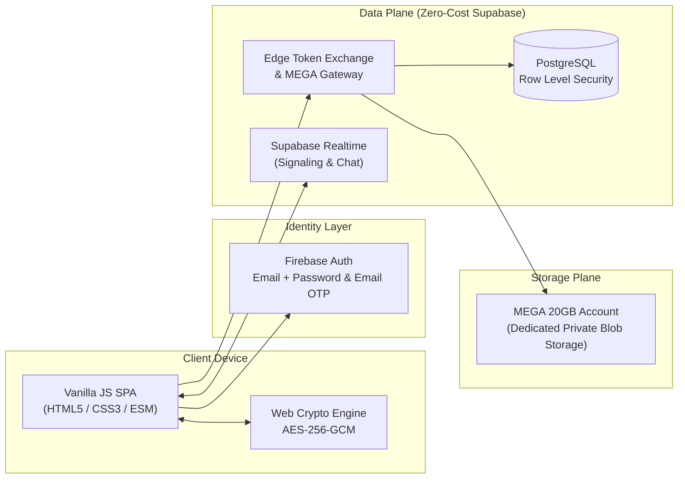

# GOSH — TECHNICAL ARCHITECTURE SPECIFICATION

---

## 1. Architectural Model

GOSH operates as a Zero-Compilation Single Page Application (SPA) paired with an edge-mediated zero-knowledge cloud backend.

---

## 2. Core Subsystems

### 2.1 Static Frontend Shell
- Built with standard Web APIs (DOM, Fetch, WebSockets, Web Crypto, WebRTC, MediaDevices).
- Zero dependencies on Node.js build pipelines for runtime.
- Hash-based client router (`#home`, `#connect`, `#calls`, `#cloud`, `#vault`, `#memories`, `#diary`, `#together`, `#music`, `#documents`, `#search`, `#devices`, `#recovery`, `#settings`).

### 2.2 Security Boundary & Token Exchange Bridge
- Firebase Authentication generates standard RS256-signed JWTs.
- Supabase Edge Functions verify the Firebase JWT against Google's public key endpoint (`https://www.googleapis.com/robot/v1/metadata/x509/securetoken@system.gserviceaccount.com`).
- The Edge Function verifies that `email` strictly matches the authorized 2-user whitelist.
- Once verified, a Supabase session JWT is minted with the user's UUID and authenticated role, enabling Supabase PostgreSQL Row Level Security (RLS) enforcement.

### 2.3 Storage Gateway (MEGA)
- Master MEGA credentials (`MEGA_EMAIL`, `MEGA_PASSWORD`) remain server-side inside Supabase Edge Function Secrets.
- Files uploaded by clients are encrypted with client-derived keys prior to upload.
- The Edge Gateway streams encrypted payloads to MEGA and returns node references to Supabase PostgreSQL.

### 2.4 Real-Time WebRTC P2P Signaling
- Supabase Realtime Broadcast channels exchange SDP Offer, SDP Answer, and ICE candidates between User 1 and User 2.
- Direct peer-to-peer data and media streaming over DTLS-SRTP.
- Google STUN servers (`stun:stun.l.google.com:19302`) resolve NAT mapping.
