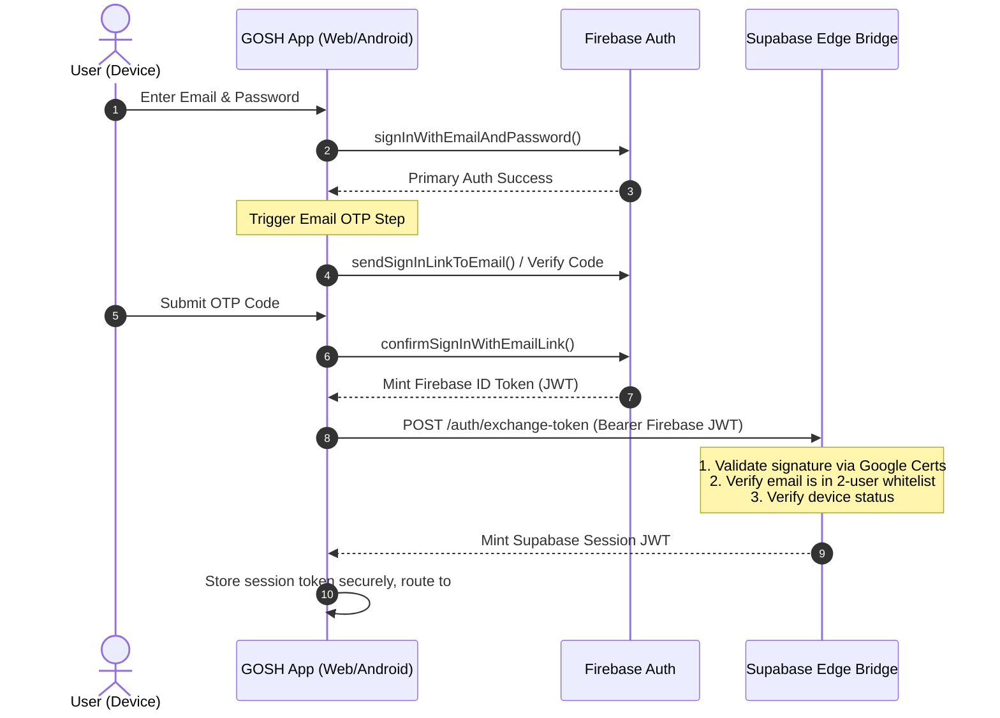

# GOSH — AUTHENTICATION & IDENTITY SPECIFICATION

---

## 1. Identity Rules & Whitelist

- **Authorized Accounts:** Exactly 2 pre-provisioned user identities:
  - **User 1:** `prasanthgokul736@gmail.com` (Display Name: `Gokul`, Role: `owner`)
  - **User 2:** `sharanyasiva4@gmail.com` (Display Name: `Sharanya`, Role: `owner`)
- **Registration Policy:** Public registration is disabled. Attempting to sign up returns an access rejection.
- **Credential Storage:** Firebase Authentication manages password salting and hashing (Argon2 / scrypt). No raw passwords touch application databases.

---

## 2. Multi-Step Authentication Workflow

---

## 3. Session & Device Management

- Active sessions are fingerprinted by User Agent, platform, and truncated IP hash.
- Tokens expire after 30 days unless revoked earlier.
- Remote revocation: either user can trigger "Revoke All Other Sessions" from Module 13 (Device Manager), instantly invalidating Supabase tokens in the database.
