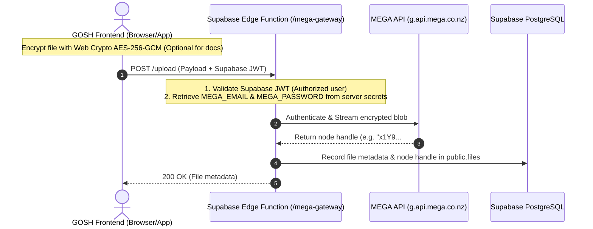

# GOSH — MEGA CLOUD STORAGE INTEGRATION SPECIFICATION

---

## 1. Storage Role & Quota

- **Provider:** MEGA (Dedicated Zero-Cost Account).
- **Free-Tier Capacity:** 20 GB permanent storage.
- **Role:** Actual blob storage for user files, photo memories, video clips, and document attachments.
- **Supabase Role:** Relational metadata only (`file_name`, `mime_type`, `file_size`, `folder_id`, `mega_node_id`, `encryption_iv`).

---

## 2. Serverless Edge Gateway Architecture

To comply with the rule that **MEGA credentials must NEVER be exposed in the frontend**, uploads and downloads pass through a stateless Supabase Edge Function gateway.

---

## 3. Streaming Downloads & Previews

- To download or preview, the client requests a signed ephemeral download stream via the Edge Gateway.
- The Edge Gateway streams the bytes directly from MEGA to the client.
- If the file is flagged as client-encrypted (`is_encrypted: true`), the browser decrypts the stream in memory using Web Crypto before presenting the preview or saving to disk.
