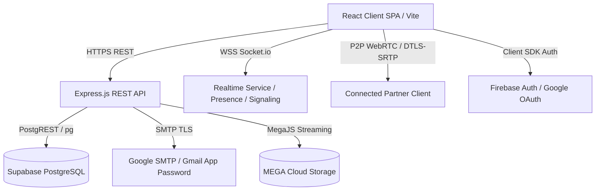

# GOSH — System Architecture & Technical Specifications

## 1. Architectural Overview

GOSH (Glimpse Of Soul Hearts) is architected as an ultra-low latency, full-stack private communication application:

## 2. Authentication Flow & Identity Resolution

Because users can log in using:
1. Registered Mobile Number (e.g., `+919876543210`)
2. Personal Unique Username (e.g., `@mayaross`)
3. Email Address (e.g., `maya@gmail.com`)

The application implements a safe, server-side identifier resolution flow:
- When a user enters a username or phone number on the login screen, `api.resolveIdentifier(identifier)` contacts the backend endpoint `/api/auth/resolve-identifier`.
- The backend matches the identifier against the `users` and `user_identifiers` tables and returns only the registered email.
- The React client then executes `signInWithEmailAndPassword(auth, resolvedEmail, password)` with Firebase Authentication.
- This guarantees passwords are never exposed to or stored inside Supabase, and plain-text passwords never touch our custom database.

## 3. Google SMTP OTP Verification

- When a user signs up or requests a password reset, `otpService.sendOtpEmail(email, purpose)` generates a cryptographically secure 6-digit random code.
- The code is hashed using `bcrypt` (salt rounds: 10) before storage in `otp_verifications` with a 10-minute expiry timestamp.
- Nodemailer connects to `smtp.gmail.com:587` with the verified Google App Password and delivers a responsive, dark romantic HTML template.
- Upon entry, the OTP is validated via `bcrypt.compare` and marked as used.

## 4. WebRTC Audio & Video Calling

- Real-time signaling is handled by Socket.io (`call_user`, `accept_call`, `reject_call`, `end_call`, `ice_candidate`).
- Once the offer and answer SDP are exchanged with Google STUN servers (`stun.l.google.com:19302`), audio and video streams flow directly peer-to-peer.
- Screen sharing is integrated using `navigator.mediaDevices.getDisplayMedia` and track replacement (`sender.replaceTrack`).

## 5. MEGA Cloud Storage for Memory Vault

- Client uploads are submitted via `multipart/form-data` to `/api/memory-vault/upload`.
- Express uses Multer `memoryStorage` to receive the buffer in memory without writing unencrypted temporary files to the disk.
- `megaStorageService.uploadFile` connects to MEGA via `megajs` with the verified account (`gosh81416@gmail.com`), streams the buffer into the account root or `GOSH_Memories` folder, and acquires the file's node ID and public link.
- File metadata is recorded in the PostgreSQL schema.
